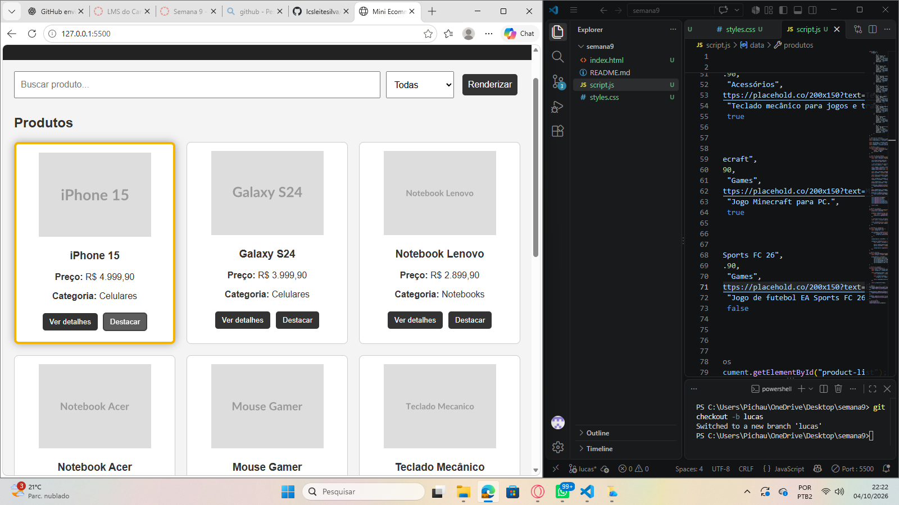
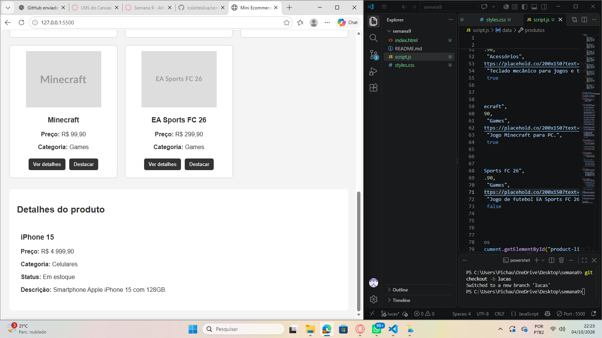
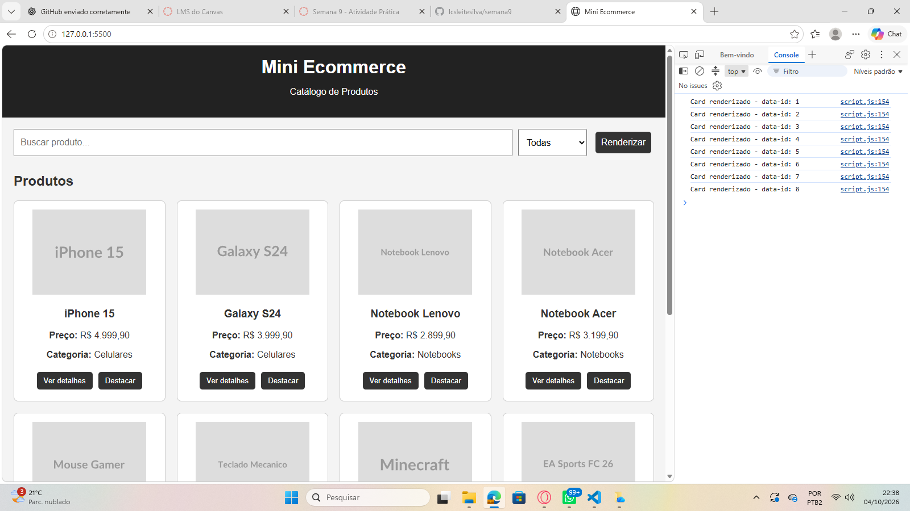

# Semana 9 - Atividade Prática: Funções e DOM

## Aluno

**Nome:** Lucas Leite Silva  
**Matrícula:** 931215

## Sobre a atividade

Nesta atividade foi desenvolvido um Mini Ecommerce utilizando HTML, CSS e JavaScript.

O projeto possui uma lista de produtos criada através do JavaScript, permitindo buscar produtos, filtrar por categoria, visualizar detalhes e destacar os cards.

## Funcionalidades

- Listagem de 8 produtos
- Busca de produtos pelo nome
- Filtro por categoria
- Botão para renderizar os produtos
- Botão "Ver detalhes"
- Botão "Destacar"
- Exibição do status de estoque
- Manipulação do DOM utilizando JavaScript

## Métodos utilizados

Durante a atividade foram utilizados:

- `getElementById`
- `querySelector`
- `querySelectorAll`
- `innerHTML`
- `createElement`
- `setAttribute`
- `appendChild`
- `classList.add`
- `style`
- `addEventListener`

## Prints da atividade

### Cards renderizados

### Detalhes do produto

### Console - querySelectorAll

O Console mostra os `data-id` dos cards obtidos através do `querySelectorAll`.

